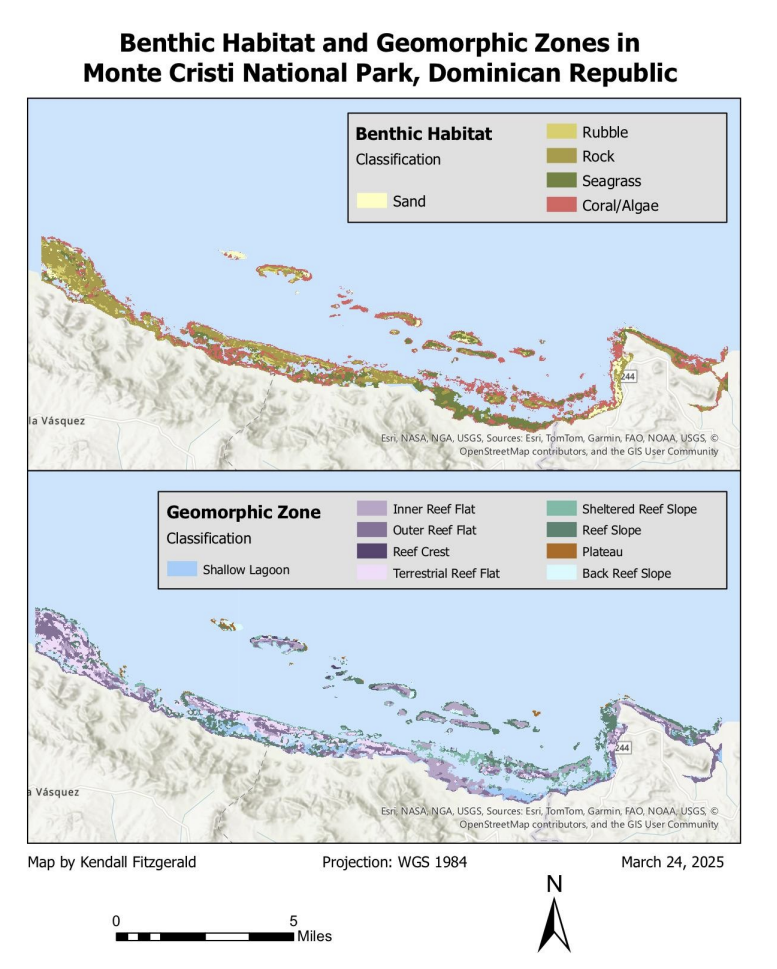
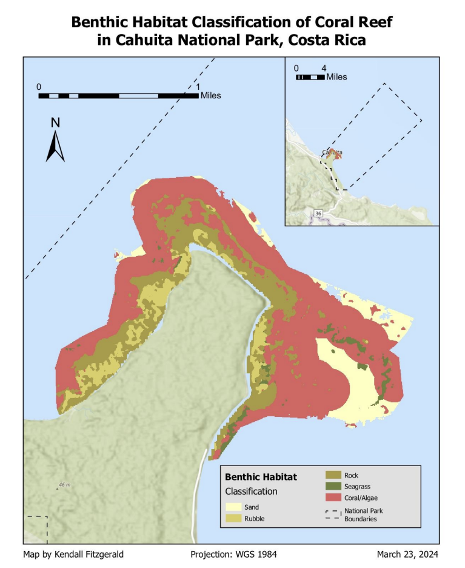

<h1 align="center">Coral Reef Habitat Mapping with Open-Source GIS and Google Earth Engine</h1>

  

  <em>Map 1: Benthic habitat (left) and geomorphic zones (right) along the northern coast of the Dominican Republic, Monte Cristi National Park.</em>

  

  <em>Map 2: Benthic habitat within Cahuita National Park, Costa Rica.</em>

## Overview
This project was completed during my Duke MEM degree and explores the Allen Coral Atlas (ACA), a global dataset of benthic habitat and geomorphic zones for shallow tropical coral reefs. Using open-source and cloud-based tools, I processed ACA data for Parque Nacional Monte Cristi in the Dominican Republic, summarized which habitat and reef-zone combinations cover the most area, and then applied the same workflow to quantify reef habitat within Cahuita National Park in Costa Rica, a marine protected area of my choosing.

## Data
- **Allen Coral Atlas** benthic habitat and geomorphic zonation maps
  ([allencoralatlas.org](https://allencoralatlas.org/)), accessed as GeoJSON and through
  [Google Earth Engine](https://developers.google.com/earth-engine/datasets/catalog/ACA_reef_habitat_v2_0) (5 m resolution)
- **World Database on Protected Areas (WDPA)** marine and coastal protected area
  boundaries, via the Esri Living Atlas

## Methods
**Part 1 – Habitat and reef-zone combinations (QGIS)**
- Loaded ACA benthic and geomorphic GeoJSON layers, which ArcGIS Pro could not read directly
- Intersected the two layers to pair each habitat type with its reef zone, then dissolved
  polygons to remove artificial splits
- Calculated area in an equal-area projection (World Mollweide) and stored outputs in a
  GeoPackage

**Part 2 – Raster extraction (Google Earth Engine)**
- Wrote a JavaScript script in the Earth Engine Code Editor to clip ACA benthic and
  geomorphic rasters to the study area and export them as GeoTIFFs
- Mapped both layers in ArcGIS Pro with class names in place of raster codes

**Part 3 – Habitat within an MPA (ArcGIS Pro + Earth Engine)**
- Selected [MPA name] from the WDPA and built a bounding box to define the extraction area
- Exported ACA benthic habitat for that area from Earth Engine
- Calculated the area of each habitat class inside the MPA boundary (Tabulate Area),
  with the workflow documented in ModelBuilder

## Key Findings
The tables below show results for each classification. Table 1 ranks benthic and geomorphic habitat combinations within Monte Cristi National Park from 1 to 5 and table 2 shows the proportion of benthic habitat types of the coral reef within Cahuita National Park in ascending order.

### Monte Cristi National Park 

| Rank | Benthic Habitat | Geomorphic Zone     | Area (km²) |
|------|-----------------|---------------------|------------|
|   1  |    Rock         | Outer Reef Flat     |  7.874     |
|   2  |   Coral/Algae   |  Reef Slope         |  6.879     |
|   3  |    Rock         |Terrestrial Reef Flat|  4.431     |
|   4  |    Seagrass     |   Inner Reef Flat   |  3.882     |
|   5  |   Coral/Algae   | Sheltered Reef Slope|  2.919     |

<em>Table 1: 5 most widespread habitat and reef-zone combinations, Monte Cristi</em>

### Cahuita National Park

| Benthic Habitat | Area (km²) |
|-----------------|------------|
| Seagrass        |  0.094     |
| Sand            |  0.452     |
| Rubble          |  0.305     |
| Rock            |   0.840    |
| Coral/Algae     |   2.134    |

<em>Table 2: Proportion of benthic habitat types, Cahuita</em>

## Tools
QGIS · Google Earth Engine (JavaScript) · ArcGIS Pro (ModelBuilder, Tabulate Area) · GeoJSON · GeoPackage

